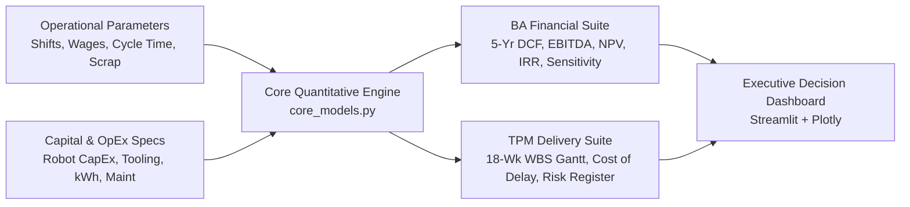

# Industrial Automation CapEx & Robot Cell Payback Simulator

[](https://industrial-robot-capex-simulator-daisy-phukan.streamlit.app/)
[](https://www.python.org/downloads/)
[](test_models.py)
[](https://opensource.org/licenses/MIT)

> **An enterprise techno-commercial decision platform bridging C-Suite Financial Justification (BA / Commercial PM) and End-to-End Workcell Commissioning Governance (TPM / Systems Delivery).**

**Author:** Daisy Phukan  
**Primary Focus:** Technical Project Management, Business & Product Analysis, Physical AI & Industrial Robotics  

---

## 📌 Executive Summary & Business Problem

In industrial manufacturing, capital allocation for robotic workcells frequently stalls at the intersection of financial justification and execution uncertainty:
1. **Commercial & Financial Friction:** Plant directors and CFOs require rigorous Discounted Cash Flow (DCF) models, straight-line depreciation tax shields, Net Present Value (NPV), and Internal Rate of Return (IRR) metrics rather than simplistic, misleading "payback" estimates that ignore operating overhead and wage inflation.
2. **Project Delivery & Operational Risk:** Technical Project Managers (TPMs) face critical-path supply chain bottlenecks, safety compliance (ISO/TS 15066), PLC/controller communication lag, and factory-floor change management. Crucially, engineering teams frequently fail to quantify the **Cost of Delay (CoD)** when field commissioning slips by 2 to 8 weeks.

This interactive platform resolves both problems. It abstracts real-world robotics deployment economics into a parametric quantitative simulation engine and executive-grade dashboard.



---

## 🎯 Dual-Lens Hiring Value

| Dimension | **Business Analyst / Commercial PM Lens** | **Technical Project Manager / Delivery PM Lens** |
| :--- | :--- | :--- |
| **Primary Metric** | 5-Year NPV, IRR, EBITDA Expansion, Tax Shields | On-time Milestone Delivery, Cost of Delay (CoD) |
| **Financial Rigor** | Straight-line depreciation schedule, 25% corporate tax shield, wage & OpEx inflation compounding | Quantifying weekly lost cash flow ($/week) + project team burn rate during commissioning slips |
| **Risk Management** | 2D sensitivity matrix (+/-15% CapEx vs. +/-25% wage rates) & Tornado chart | 5x5 quantitative risk register with active technical mitigations (EOAT lead-time, PLC protocol, safety scanners) |
| **Execution Governance** | Unit economics per part, scrap reduction EBITDA uplift | 18-Week Work Breakdown Structure (WBS) spanning Discovery, TRD, FAT, On-Site Commissioning, and Handover |
| **Hardware Trade-offs** | Total Cost of Ownership (TCO) comparison | Cobot vs. Industrial Articulated Robot vs. Manual Line payload, speed, and safety zoning trade-offs |

---

## 🚀 Key Modules & Capabilities

### 1. Executive Summary & Breakeven Curve
- **High-Impact KPI Cards:** Instant calculation of Net 5-Year NPV, Internal Rate of Return (IRR %), Simple Payback (months), Discounted Payback (months), and 5-Year Cumulative ROI %.
- **Cumulative Cash Flow Trajectory:** Interactive Plotly chart tracing Year 0 capital outflow through Year 5 cumulative cash flow, dynamically highlighting the breakeven milestone.

### 2. Business Analyst Financial Suite
- **Granular Labor & OpEx Modeling:**
  - Multi-shift headcount (1 to 3 shifts/day, 8 to 12 hrs/shift).
  - Benefits & healthcare overhead percentage + annual turnover churn & re-hiring training costs.
  - Ongoing robot operational expenditure (preventive maintenance % of CapEx, kWh energy consumption, annual software licenses, and tooling consumables).
- **Quality & Throughput Value Capture:**
  - Quantifies scrap rate delta percentage against baseline production volume and cost per unit.
  - Computes cycle time delta and theoretical plant capacity expansion.
- **5-Year Straight-Line Depreciation DCF Waterfall:**
  - Full financial schedule detailing Gross Savings, Robot OpEx, EBITDA, Depreciation Tax Shield, EBIT, Taxes, NOPAT, and Free Cash Flow (FCF).
  - One-click CSV export for offline executive reviews.
- **Scenario Planning & Sensitivity Analysis:**
  - 2D Matrix evaluating 5-Year NPV against dual variances in CapEx ($k) and Hourly Wages ($/hr).
  - Tornado Sensitivity Chart identifying top EBITDA drivers (Labor savings vs. Scrap reduction vs. Maintenance overhead).

### 3. Technical Project Management & Governance Suite
- **Interactive Cost of Delay (CoD) Simulator:**
  - Sliders for commissioning schedule slip (1 to 12 weeks) and weekly engineering burn rate.
  - Real-time quantification of forfeited operational cash flow + additional PM burn to justify proactive expediting decisions.
- **18-Week Work Breakdown Structure (WBS) Gantt Schedule:**
  - Complete workcell lifecycle across 5 phases: *Discovery & Feasibility, Engineering Design (TRD & EOAT), Build & Integration, Testing & Validation (FAT), and Production Ramp & UAT*.
  - Activity status tracking (`Complete`, `In Progress`, `Pending`) and designated cross-functional owners.
- **Quantitative Risk Register (5x5 Matrix):**
  - Evaluates supply chain lead-times, PLC bus communication protocol mismatches (Modbus vs. PROFINET), ISO/TS 15066 safety zoning, and operator change management with concrete mitigations.

### 4. Techno-Commercial Architecture Comparison
- **Cobot vs. Industrial Robot vs. Manual Line:**
  - Comprehensive comparison matrix contrasting payload, cycle speed, safety enclosure needs, footprint, and reprogramming flexibility.
  - 6-Axis Plotly Radar Chart visually contrasting capital intensity, throughput velocity, footprint impact, and deployment speed.

---

## 🏭 Enterprise Scenario Presets

The simulator includes 4 pre-configured industrial archetypes reflecting real-world production environments:
1. **Automotive Tier-1 Screwdriving (2-Shift):** High-precision torque control, cobot cell with SICK safety scanner, moderate wage tier, scrap reduction focus.
2. **Electronics PCB Pick-and-Place (3-Shift 24/7):** High annual volume (450k units), 24/7 operations, rapid cycle time compression, and high turnover mitigation.
3. **CNC Machine Tending (1-to-2 Shift Expansion):** Machine door interlock integration, heavy payload, high skilled-machinist wage rates, capacity bottleneck resolution.
4. **Heavy Palletizing & Packaging:** End-of-line material handling, high throughput, high payload, safety fencing, and significant worker ergonomic injury avoidance.

---

## 🛠️ Repository Structure

```text
industrial-robot-capex-simulator/
│
├── app.py                   # Main Streamlit web application & Plotly visualizations
├── core_models.py           # Quantitative financial engine, DCF math, WBS & risk logic
├── test_models.py           # Comprehensive unittest suite (100% core logic coverage)
├── requirements.txt         # Minimal, production-pinned Python dependencies
└── README.md                # System documentation, architectural overview & methodology
```

---

## 💻 Installation & Local Execution

### Prerequisites
- Python 3.10 or higher
- Git

### Setup Steps
```bash
# 1. Clone repository
git clone https://github.com/Daizy-Mgmt/industrial-robot-capex-simulator.git
cd industrial-robot-capex-simulator

# 2. Create and activate a virtual environment
python -m venv venv
# On Windows:
venv\Scripts\activate
# On macOS/Linux:
source venv/bin/activate

# 3. Install dependencies
pip install -r requirements.txt

# 4. Run the unit test suite to verify math engine
python -m unittest test_models.py

# 5. Launch the Streamlit application
streamlit run app.py
```
The application will launch automatically in your browser at `http://localhost:8501`.

---

## 🧪 Unit Testing & Verification

The quantitative models are protected by unit tests verifying mathematical integrity:
```bash
python -m unittest -v test_models.py
```
**Test Coverage Includes:**
- Multi-shift labor compounding and turnover churn formulas.
- Straight-line depreciation tax shields and multi-year DCF Free Cash Flow schedules.
- Net Present Value (NPV) and Internal Rate of Return (IRR) numerical convergence.
- Payback period fractional month interpolation.
- Weekly Cost of Delay (CoD) and PM burn calculations.
- 2D CapEx vs. Wage rate sensitivity matrix generation.
- Enterprise scenario preset structural integrity.

---

## 📊 Financial Modeling Methodology & Equations

### 1. Annual Manual Labor Cost
$$\text{Total Operators} = \text{Operators per Shift} \times \text{Shifts per Day}$$
$$\text{Direct Wages} = \text{Total Operators} \times (\text{Hours/Shift} \times \text{Days/Year}) \times \text{Hourly Wage}$$
$$\text{Total Labor Cost} = \text{Direct Wages} \times (1 + \text{Benefits Overhead \%}) + (\text{Total Operators} \times \text{Turnover Rate \%} \times \text{Training Cost})$$

### 2. Free Cash Flow (FCF) with Depreciation Tax Shield
$$\text{EBITDA}_t = \text{Gross Savings}_t - \text{Robot OpEx}_t$$
$$\text{Depreciation}_t = \frac{\text{Initial CapEx}}{\text{Depreciation Life (Years)}}$$
$$\text{EBIT}_t = \text{EBITDA}_t - \text{Depreciation}_t$$
$$\text{NOPAT}_t = \text{EBIT}_t \times (1 - \text{Corporate Tax Rate})$$
$$\text{FCF}_t = \text{NOPAT}_t + \text{Depreciation}_t$$

### 3. Net Present Value (NPV) & Cost of Delay
$$\text{NPV} = \sum_{t=1}^{5} \frac{\text{FCF}_t}{(1 + r)^t} - \text{CapEx}_0$$
$$\text{Cost of Delay (CoD)} = \left(\frac{\text{Year 1 EBITDA}}{52}\right) \times \text{Delay Weeks} + (\text{Weekly PM Burn} \times \text{Delay Weeks})$$

---

## 📄 License & Attribution

Distributed under the **MIT License**. Created as a professional portfolio demonstration of commercial systems analysis, financial engineering, and technical project management in advanced robotics.
